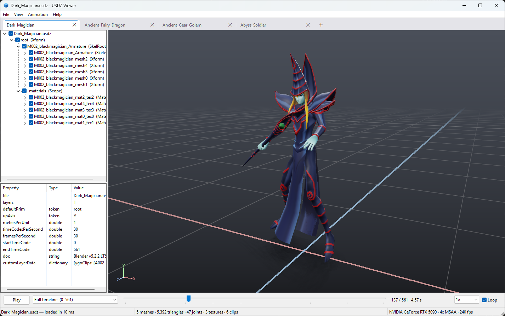

# USDZ Viewer

A native Windows viewer for USD files — `.usdz`, `.usdc`, `.usda`, `.usd` — and their animations.
It is a single self-contained executable (Win32 + Direct3D 11 + Windows Imaging Component) with its own
USD reader: no OpenUSD, Python or other runtime dependencies.



## Download

Get `USDZViewer.exe` from the [latest release](../../releases/latest): a single executable for 64-bit
Windows 10 / 11, nothing to install. `usdzinfo.exe` (the command line inspector) is attached too.

## Features

**USD support**
- `.usdz` packages (stored or deflated zip entries), binary crate `.usdc` (format 0.4 – 0.10, including
  compressed arrays) and text `.usda`.
- Composition: sublayers (with time offsets), references and payloads (internal, inside the package or on disk,
  `package.usdz[file]` paths), inherits, specializes, variant sets with authored selections.
- Geometry: `Mesh` (polygons, holes, `leftHanded` orientation, face-varying/vertex/uniform/constant primvars
  with indices, authored or computed normals, `GeomSubset` material bindings), implicit `Cube`, `Sphere`,
  `Cylinder`, `Cone`, `Capsule`, `Plane`, and `PointInstancer`.
- Transforms: every `xformOp` type (translate, scale, rotateX/Y/Z, all six rotate orders, orient, transform,
  `!invert!`, `!resetXformStack!`), time-sampled visibility, `purpose` (guide/proxy hidden), `upAxis = Z`.
- Animation: time-sampled transforms, **UsdSkel** skeletons with `SkelAnimation` (linear blend skinning on the
  GPU, `skel:joints` remapping, `geomBindTransform`), **blend shapes**, and point (vertex) animation.
  Values are interpolated like USD does (linear, quaternion slerp, held for non-interpolatable types).
- Materials: `UsdPreviewSurface` — diffuse/emissive/specular color, metallic, roughness, opacity (blended or
  `opacityThreshold` cut-outs), normal maps, occlusion, `UsdUVTexture` (wrap modes, scale/bias, channels,
  color space), `UsdPrimvarReader_float2`, `UsdTransform2d`, material interface inputs, `NodeGraph`s,
  `strongerThanDescendants` bindings. Meshes without a material use `displayColor`/`displayOpacity`.
- **Animation clips**: the clip table that the Yu-Gi-Oh! converter writes to `customLayerData.ygoClips`
  appears in the clip list, so each clip of a combined timeline can be played and looped on its own.
- **Clip blending**: switching clips crossfades from the outgoing clip (which keeps playing meanwhile) into the
  new one (0.3 s by default;
  Animation → Clip Blending sets 0.15 – 1 s or turns it off). Joint and transform rotations are slerped,
  translations, scales, blend shape weights and point animation interpolated. A clip that restarts with a jump
  when it loops, and the step from one clip into the next while playing the whole timeline, are blended the same
  way; loops that already continue seamlessly are left alone. Scrubbing and frame stepping show exact frames.

**Viewer**
- PBR shading with a camera-relative studio light rig, HDR rendering, 4× MSAA, ACES tonemapping,
  anti-aliased alpha cut-outs, soft ground contact shadow, ground grid, axis gizmo, skeleton overlay,
  wireframe modes, base color / normals debug views, exposure control.
- **Ruler** (M): bounding box with width / depth dimension lines and a height ruler with tick marks, labelled in
  metric and imperial units (using the stage's `metersPerUnit`). It measures the model as currently posed, or just
  the selected part when one is selected (click a mesh or pick a prim in the hierarchy); the status bar shows
  W × H × D.
- **Tabs**: opening a file (Ctrl+O, drag and drop, or the command line) puts it in a new tab rather than replacing
  what is open; selecting several files opens one tab each. Every tab keeps its own models, camera, selection,
  hierarchy (including which rows are expanded) and playback; tabs in the background pause. Close a tab with its ×,
  a middle-click or Ctrl+F4; drag tabs to reorder them; the + button or Ctrl+T adds an empty tab, which the next
  opened file fills. Ctrl+Tab / Ctrl+Shift+Tab (or Ctrl+Page Down / Up) and Ctrl+1 … 9 switch tabs.
- **Several models in one tab**: File → Open Additional (Ctrl+Shift+O, multi-select) or Ctrl + drag and drop adds
  files to the current tab. Models are placed side by side (spaced by their animated extents), each gets a row in
  the hierarchy (its check box hides the whole model) and keeps its own clip and time; Space plays them all, while
  the timeline, clip list and frame stepping control the active model (the one selected in the hierarchy, shown in
  bold). Close Model (Ctrl+W) removes the active model (closing a tab's last model closes the tab); Page Up/Down
  and F5 act on it.
- Prim hierarchy with visibility check boxes, a property inspector (values at the current time),
  click-to-select in the viewport, and a scene report (Ctrl+I) with layers, meshes, materials, textures,
  skeletons, clips and warnings.
- Timeline with play/pause, frame stepping, clip selection, playback speed and looping; "follow" camera for
  models that move around; drag-and-drop; Page Up / Page Down steps through the USD files in a folder.
- Files load on a background thread (textures decode in parallel); per-monitor DPI aware.
- **Steady frame rate** (View menu, on by default): while the viewer is the active window it presents a frame every
  refresh, re-showing the last image when nothing changed (only the cheap final pass runs). Variable-refresh
  displays — G-SYNC / FreeSync, OLEDs in particular — otherwise flicker when the frame rate jumps between idle and
  active. Windows can scan a windowed app's swap chain out directly (multiplane overlays), and NVIDIA then applies
  G-SYNC even when it is set to "full screen mode only".

## Controls

| Input | Action |
| --- | --- |
| Left drag | Orbit |
| Right drag, middle drag, Shift + left drag | Pan |
| Wheel, Ctrl + drag | Zoom |
| Click / double-click | Select mesh / frame the scene |
| Space | Play / pause |
| Left / Right, Home / End | Previous / next frame, first / last frame |
| Up / Down (or `[` / `]`) | Previous / next clip (crossfaded) |
| L | Loop |
| F, R, T | Frame scene, reset camera, follow animation |
| G, S, K | Grid, ground shadow, skeleton |
| M | Ruler (measures the selection, or the whole model) |
| W, B | Shaded / wireframe / both, show back faces |
| 1, 2, 3 | Lit, base color, normals |
| + / − / 0 | Exposure up / down / reset |
| Ctrl+O, drag and drop | Open in a new tab |
| Ctrl+Shift+O, Ctrl + drop | Add models to the current tab, alongside the open ones |
| F5 | Reload the active model |
| Ctrl+W | Close the active model (a tab's last model closes the tab) |
| Page Up / Page Down | Replace the active model with the previous / next USD file in its folder |
| Ctrl+T, Ctrl+F4 (or middle-click) | New tab, close tab |
| Ctrl+Tab, Ctrl+Shift+Tab (or Ctrl+Page Down / Up) | Next / previous tab |
| Ctrl+1 … Ctrl+8, Ctrl+9 | Go to that tab, to the last tab |
| Ctrl+H, Ctrl+I, F1 | Hierarchy panel, scene info, controls |

The executable can also be started with files: `USDZViewer.exe model.usdz` (so it works with "Open with"); each
file opens in its own tab.

## Building

Requires Visual Studio 2022 with the **Desktop development with C++** workload (it includes CMake, Ninja and the
Windows SDK). From a command prompt in this folder:

```bat
build.bat
```

The viewer is written to `build\Release\USDZViewer.exe` (statically linked, no redistributables needed).
`build.bat Debug` makes a debug build. The project can also be opened with Visual Studio's "Open Folder".

## Command line inspector

`build\Release\usdzinfo.exe` prints the same report as the Scene Info window plus the composed prim tree:

```bat
usdzinfo model.usdz                          :: layers, metadata, meshes, materials, clips, prim tree
usdzinfo model.usdz --dump-layer layer.json  :: every spec and field of the root layer
usdzinfo model.usdz --eval 24 points.json    :: world-space skinned points at time code 24
usdzinfo model.usdz --eval 24 points.json --blend-from 10 0.5   :: halfway through a crossfade from 10 to 24
```

## Tests

`tests/run_tests.sh` checks the reader and the scene evaluation against Pixar's own USD library (the copy that
ships with Blender, used only for testing):

```bash
tests/run_tests.sh "C:/Program Files/Blender Foundation/Blender 5.2/blender.exe" [more files to check...]
```

It generates test packages with `tests/make_test_assets.py` (composition, skinning + blend shapes, Z-up) and
compares every spec/field of each layer (`compare_layers.py`) and the world-space positions of every mesh point
at several times (`compare_eval.py`). `tests/make_material_test.py` builds a material showcase file.

## Limitations

- Subdivision surfaces are drawn as their control mesh (smooth-shaded); curves, points and volumes are not drawn.
- MaterialX and other non-UsdPreviewSurface shading networks fall back to display colors.
- Value clips, splines, collection-based material bindings, list-op deletions across layers and implied
  inherits across reference boundaries are not supported. Skinning uses the four strongest joint influences.
- Image formats are whatever Windows Imaging Component can decode (PNG, JPEG, BMP, TIFF, GIF, plus installed
  codecs such as WebP/HEIF); EXR textures are not supported.

## Layout

```
src/usd/      archive (zip), crate (.usdc), usda (.usda), layer, stage (composition, value resolution)
src/scene/    render-oriented scene: transforms, meshes, materials, skeletons, animation evaluation
src/render/   Direct3D 11 renderer, HLSL shaders, WIC image decoding
src/app/      Win32 application (main window, hierarchy, timeline), resources
tools/        usdzinfo command line inspector, icon generator
tests/        pxr-based reference dumps, comparisons and test asset generators
```

## License

MIT, see [LICENSE](LICENSE). Yu-Gi-Oh! is a trademark of Konami; this project is not affiliated with or endorsed
by Konami, and the screenshot only shows a model converted for personal viewing.
